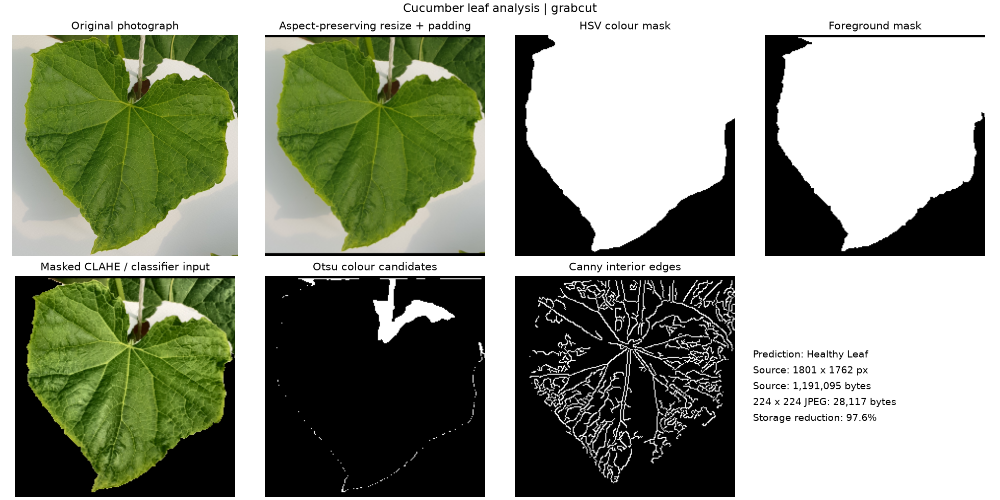

# Cucumber leaf classification under field-like image variation

## Abstract and objective
This project examines whether explicit image processing can reduce storage, isolate leaf tissue and retain visual information for five-way classification. It pairs an OpenCV preprocessing pipeline with a CPU MobileNetV2 classifier. On the historical 1,004 matched images, preprocessing saved 80.40% of file storage. On 151 test images, the original raw-image neural baseline correctly classified 144 images and the historically preprocessed model correctly classified 135. The live workflow evaluates the additional constraint of handling a photograph whose label is unknown.

## Theory and methodology
Colour segmentation estimates which pixels belong to vegetation. HSV separates hue from brightness. Morphological closing bridges small gaps, opening removes isolated pixels, and contour filling retains pale objects within a leaf. GrabCut uses foreground and background appearance plus spatial continuity to refine the colour mask. Coverage below 10% or above 85% triggers a conservative fallback. This matters when the frame is mostly leaf or the colour prior is weak.

Aspect-preserving scaling uses s = 224 / max(width, height). Padding centres the scaled region. CLAHE redistributes luminance locally on a clipped histogram while preserving the LAB chromatic channels. Otsu selects a threshold that maximizes the variance between two pixel groups. Restricting the threshold calculation to foreground a* values helps localize colour changes. Canny highlights intensity transitions inside the eroded foreground. Both maps help interpret the image. Classification uses normalized RGB values from the masked, enhanced JPEG.

~~~text
Photo → oriented RGB → BGR → resize and pad → HSV prior → adaptive foreground mask
                                 │                               │
                                 └──────── LAB CLAHE ────────────┤
                                                                 ├→ masked JPEG → MobileNetV2 → class
                                                                 ├→ foreground Otsu colour candidates
                                                                 └→ interior Canny edges
~~~

The grouped split contains 702 training, 151 validation and 151 test images. Persistent source-photo grouping reduces leakage between pest crops. The five test supports are Healthy Leaf 6, Leaf Miner 10, Red Mite 45, Whitefly 45 and Yellow Mosaic 45. Two categories use proxy hosts. [Dataset sources and split](dataset_construction.md)

## Implementation and visual results
The live path accepts a single unlabelled image, applies the same pixel-based segmentation decision across classes, encodes at JPEG quality 95, then loads the saved processed-image model. The training-era batch pipeline used class-specific segmentation exceptions. The new evaluation measures the existing checkpoint under the presentation path. [Live implementation](../src/leaf_demo.py) · [Parameters and execution](PRESENTATION_GUIDE.md)

Figure 1 shows where the algorithm succeeds and fails. The foreground mask removes the left background and retains the leaf blade. Contour filling also retains a light gap beside the stem. The Otsu panel highlights that gap on a healthy example, and Canny responds strongly to veins. These are appearance features that need interpretation. The source uses 1,191,095 bytes and its processed JPEG uses 28,117 bytes. The unusually large original makes this example's 97.6% reduction higher than the historical dataset average.

## Experimental results and discussion
The historical matched dataset shrank from 96.11 MB to 18.83 MB. Raw MobileNetV2 achieved 95.36% accuracy, compared with 89.40% for the historical processed variant. In the saved full-image noise experiment, processed accuracy was 55.63% and raw accuracy was 34.44%. Different rankings under clean and noisy conditions show why both the perturbation and test population must be specified. The controlled storage experiment below holds JPEG quality and test images fixed across derived stages. [Model comparisons and additional experiments](RESULTS_AND_DISCUSSION.md) · [Noise results](../results/metrics/ood_background_swap_results.csv)

**Table 1. Storage for the same 151 test photos.** Each derived image uses JPEG quality 95. MB uses decimal units.

| Stage | Total MB | Reduction from original |
| --- | ---: | ---: |
| Original files | 13.730 | — |
| Resize, pad and encode | 2.362 | 82.80% |
| Add luminance CLAHE | 3.103 | 77.40% |
| Apply foreground mask | 2.678 | 80.50% |

CLAHE added 0.741 MB at fixed dimensions and encoding quality. Masking recovered 0.426 MB. The final image retains enhanced detail at a modest storage cost over the resize-only baseline. [Measured bytes](../results/metrics/dip_stage_storage.csv)

The live path classified **132/151 (87.42%)** correctly, with macro-F1 **0.8427**. Of the 19 errors, 14 were Whitefly called Leaf Miner and three were Whitefly called Red Mite. Whitefly recall fell from 31/45 in the historical processed run to 28/45. Inspect the pest details in those images before attributing the errors to segmentation. Healthy recall was 6/6, with substantial uncertainty given its small support. [Per-class precision, recall, F1 and confusion matrix](../results/metrics/demo_classification_report.txt) · [Per-image predictions](../results/metrics/demo_predictions.csv)

## Conclusion and limitations
Foreground isolation and storage savings are demonstrable on the supplied dataset. Cropped pest images, proxy hosts, small minority-class test supports and background remnants limit transfer to whole cucumber leaves. Independent whole-leaf testing under the actual presentation conditions is the remaining empirical requirement. The evidence supports separate discussion of storage, visual feature preservation and classification accuracy.

## References and reproducibility appendix
The assignment identifies Menco-Tovar, Martinez-Santos and Puertas, “Detection of diseases in cucumber using deep neural networks,” Neural Computing and Applications (2026), DOI 10.1007/s00521-026-11945-z. Method references and dataset provenance are available in the [existing bibliography](../MLEE_Final_Report.pdf) and [dataset construction notes](dataset_construction.md). The [assignment](../project-task.jpeg) and [grading guide](../guidelines.png) define the submission criteria.

From the project directory after environment and data setup, run the complete presentation experiment with the command below. It generates the single-image panel, test predictions, per-class metrics, confusion matrix and storage measurements. Training scripts for both neural baselines and the classical comparisons are in src. [Presentation setup](PRESENTATION_GUIDE.md) · [Experiment launcher](../run_dip.ps1)

~~~powershell
.\run_dip.ps1 -Photo ".\data\raw\test\Healthy\healthy_0009.jpg"
~~~

